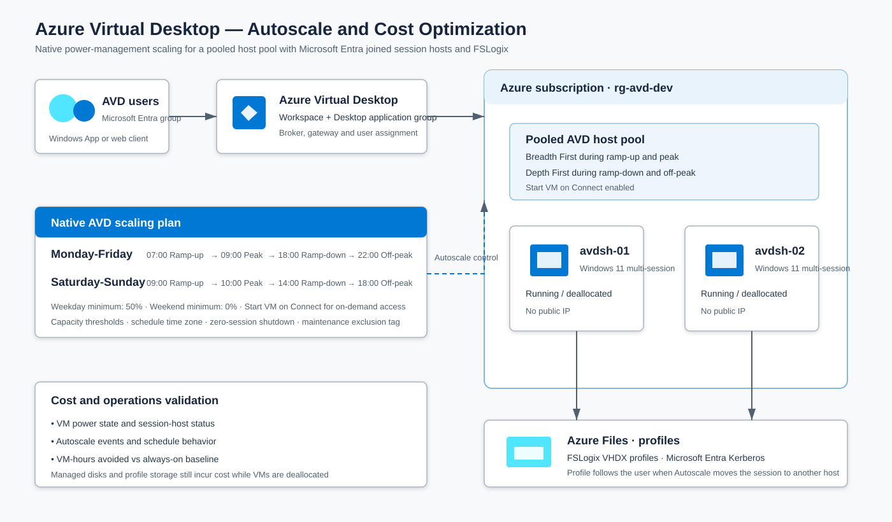

# Azure Virtual Desktop Autoscale and Cost Optimization

This project deploys a pooled Azure Virtual Desktop lab and applies a native AVD scaling plan to control when session-host VMs run.

It is intended for proof-of-concept work, self-learning, demonstrations, and testing AVD power-management behavior without building the environment manually each time.

> This is a lab reference, not a production landing zone. Review networking, security, monitoring, backup, image management, profile recovery, and Terraform state before using the design in production.

## Architecture



[Open the editable Draw.io diagram](diagrams/avd-autoscale-architecture.drawio)

A step-by-step walkthrough of this lab is on the blog: [AVD Autoscale Lab with Terraform](https://adnanasiddiqui.com/terraform-labs/avd-autoscale-cost-lab/).

## What this lab demonstrates

- Native AVD power-management autoscale for a pooled host pool.
- Four schedule phases: ramp-up, peak, ramp-down, and off-peak.
- Breadth First load balancing while users arrive.
- Depth First load balancing while capacity is reduced.
- Drain mode and safe host shutdown when sessions reach zero.
- Start VM on Connect for an available desktop when all hosts are stopped.
- Subscription-level AVD service-principal roles required by Autoscale and Start VM on Connect.
- FSLogix profiles stored on Azure Files with Microsoft Entra Kerberos.
- A simple method to compare always-on compute with a scheduled lab.

## What gets deployed

| Component | Default configuration |
|---|---|
| Resource group | `rg-avd-dev` |
| Host pool | Pooled |
| Session hosts | Two Microsoft Entra-joined VMs |
| VM size | `Standard_D4s_v5` — 4 vCPUs and 16 GiB RAM per VM |
| Operating system | Windows 11 Enterprise multi-session with Microsoft 365 Apps |
| Load balancing | Breadth First during ramp-up/peak; Depth First during ramp-down/off-peak |
| Start VM on Connect | Enabled |
| Scaling plan | Native AVD power-management scaling plan |
| Default schedule | Separate weekday and weekend schedules in Central Standard Time |
| Network | `10.20.0.0/16` VNet and `10.20.1.0/24` session-host subnet |
| Public VM IPs | None |
| Profile storage | Standard Azure Files with ZRS |
| FSLogix share | `profiles`, 1,024 GiB quota |
| File authentication | Microsoft Entra Kerberos |

Terraform also installs the AVD Agent, enables `AADLoginForWindows`, configures FSLogix, assigns the desktop and VM-login roles to the AVD user group, and assigns the required autoscale roles to the Azure Virtual Desktop service principal.

## Seven-day scaling schedule

The schedule uses the Windows time-zone name configured in `autoscale_time_zone`.

### Monday-Friday

| Phase | Start | Minimum hosts | Load balancing | Purpose |
|---|---:|---:|---|---|
| Ramp-up | 07:00 | 50% | Breadth First | Start capacity before users arrive |
| Peak | 09:00 | Based on demand | Breadth First | Spread sessions across available hosts |
| Ramp-down | 18:00 | 0% | Depth First | Consolidate sessions and stop unused hosts |
| Off-peak | 22:00 | Based on demand | Depth First | Keep compute off until it is required |

### Saturday-Sunday

| Phase | Start | Minimum hosts | Load balancing | Purpose |
|---|---:|---:|---|---|
| Ramp-up | 09:00 | 0% | Breadth First | Leave hosts off until weekend demand appears |
| Peak | 10:00 | Based on demand | Breadth First | Add capacity only when required |
| Ramp-down | 14:00 | 0% | Depth First | Consolidate any weekend sessions |
| Off-peak | 18:00 | Based on demand | Depth First | Return to on-demand operation |

This is a clear lab example, not a universal Microsoft schedule. Microsoft recommends defining schedules from actual usage patterns and allows different schedules for weekdays and weekends. The default lab never forces users to sign out. A VM is stopped only when it has no sessions.

## Before you start

You need:

- An active Azure subscription.
- Owner or User Access Administrator permission at subscription scope, plus permission to create the lab resources.
- Terraform 1.9 or newer.
- Azure CLI and Visual Studio Code.
- A Microsoft Entra security group for AVD users.
- Eligible Microsoft licensing for Azure Virtual Desktop.
- A Windows 11 multi-session Marketplace image available in the selected region.

## Run the lab from Visual Studio Code

Yes, the project can be run directly from a VS Code PowerShell terminal. Complete the following sections in order. Do not run `terraform apply` before creating and reviewing `terraform.tfvars`.

## 1. Download and open the project

Clone or download the repository, then open the folder containing `main.tf` in Visual Studio Code.

Open a new VS Code PowerShell terminal and sign in:

```powershell
az login
az account set --subscription "<SUBSCRIPTION_ID_OR_NAME>"
```

Confirm the selected subscription:

```powershell
az account show --query "{Name:name,Subscription:id,Tenant:tenantId}" --output table
```

## 2. Prepare the variables file

Create a local variables file:

```powershell
Copy-Item terraform.tfvars.example terraform.tfvars
```

Open `terraform.tfvars` and replace every placeholder. At minimum, update:

- `subscription_id`
- `location`
- `windows_image_version`
- `admin_password`
- `avd_user_group_object_id`
- `avd_service_principal_object_id`
- `storage_account_name`
- `autoscale_time_zone`
- `autoscale_schedules` only if the default weekday/weekend design does not match your test

`terraform.tfvars` is ignored by Git. Never upload it.

### Find the Windows image version

```powershell
az vm image list `
  --location eastus `
  --publisher MicrosoftWindowsDesktop `
  --offer office-365 `
  --sku win11-24h2-avd-m365 `
  --all `
  --query "sort_by(@, &version)[-1].version" `
  --output tsv
```

Use the same region in this command and in `terraform.tfvars`.

### Find the AVD service-principal object ID

Microsoft's AVD service application ID is `9cdead84-a844-4324-93f2-b2e6bb768d07`. Its object ID is different in every tenant.

```powershell
az ad sp show `
  --id 9cdead84-a844-4324-93f2-b2e6bb768d07 `
  --query id `
  --output tsv
```

Copy the result into `avd_service_principal_object_id`. Do not enter the application ID itself.

## 3. Review the schedule

The example uses `Central Standard Time`. List valid Windows time-zone names if another zone is required:

```powershell
Get-TimeZone -ListAvailable | Select-Object Id, DisplayName
```

The default `autoscale_schedules` value is defined in `variables.tf`. Copy the full list into `terraform.tfvars` only when you want to change it. Each day must appear exactly once.

Within each schedule, phase times must be in chronological order:

```text
ramp-up < peak < ramp-down < off-peak
```

For a quick autoscale test, copy `autoscale_schedules` into `terraform.tfvars`, then temporarily move the schedule for the current day so ramp-down and off-peak occur shortly after deployment. Restore the seven-day schedule after testing.

## 4. Deploy

```powershell
terraform init
terraform fmt -check -recursive
terraform validate
terraform plan -out=avd-autoscale.tfplan
terraform apply "avd-autoscale.tfplan"
```

Review the plan before applying it. The role assignments are made at subscription scope because Microsoft requires that scope for native Autoscale and Start VM on Connect.

## 5. Complete the FSLogix profile setup

Terraform deploys the Azure resources, but Microsoft Entra Kerberos consent and the FSLogix folder ACL must still be checked in the tenant.

Yes, the FSLogix post-deployment steps are still required for a new storage account. Complete them once after the first deployment:

1. Grant consent to the storage-account enterprise application.
2. Add `kdc_enable_cloud_group_sids` for cloud-only users.
3. Confirm the AVD user group has `Storage File Data SMB Share Contributor` on the profile share.
4. Set the root-folder ACL for `AVD_Users` and `CREATOR OWNER`.
5. Sign in as a test user and confirm that the FSLogix VHDX is created.
6. Sign out, sign in again, and verify profile persistence.

Follow [Post-deployment configuration](docs/post-deployment.md) for the exact portal locations. You do not repeat these steps every day. Repeat them only if the storage account/share is recreated, the identity design changes, or the ACL is removed.

## 6. Validate Autoscale

Follow [Autoscale validation](docs/autoscale-validation.md).

For a complete Monday-Sunday demonstration, use the [Seven-day test plan](docs/seven-day-test-plan.md).

The validation covers:

- Scaling-plan association and status.
- Subscription-level service-principal roles.
- Session-host availability and VM power state.
- Ramp-down, drain mode, and deallocation.
- Start VM on Connect.
- Autoscale logs and common failure points.

## Cost test

This repository does not publish a fixed dollar saving because VM, disk, storage, region, agreement, and tax rates change. It provides the runtime calculation instead.

For two VMs:

```text
Always-on compute hours per month = 2 × 24 × 30 = 1,440 VM-hours
Scheduled compute hours per month = 2 × daily running hours × 30
Compute hours avoided = always-on hours - scheduled hours
```

Example: if both hosts would otherwise run 24 hours but average only 12 running hours per day, the maximum compute-hour reduction is approximately 50%. Actual savings are lower when Autoscale starts extra capacity for demand, and managed disks and profile storage continue to incur charges while VMs are deallocated.

Use the [Azure Pricing Calculator](https://azure.microsoft.com/pricing/calculator/) with your region and agreement. Record the result using [Cost analysis](docs/cost-analysis.md).

## Project structure

```text
modules/     Reusable Terraform modules, including native AVD Autoscale
scripts/     Session-host configuration and validation scripts
docs/        Setup, validation, cost, and troubleshooting guides
diagrams/    Architecture diagram and editable Draw.io source
```

## Remove the lab

```powershell
terraform plan -destroy -out=destroy.tfplan
terraform apply "destroy.tfplan"
```

Destroying the storage account permanently removes the lab's FSLogix profiles. Confirm that no data is required before continuing.

## Important notes

- Use either native AVD Autoscale or another scaling tool on a host pool, never both.
- A pooled host pool can be associated with only one scaling plan.
- Native Autoscale can overwrite drain mode. Add the `excludeFromScaling` tag to a VM before planned maintenance.
- Start VM on Connect starts capacity for a connection; it does not replace the scaling schedule.
- Deallocated VMs stop compute charges, but disks, profiles, monitoring, backup, and outbound data can still cost money.
- Never commit `.tfvars`, state files, saved plans, passwords, storage keys, or registration tokens.
- Use a protected remote Terraform backend for team or production use.

## Microsoft documentation

- [Autoscale scaling plans and example scenarios](https://learn.microsoft.com/azure/virtual-desktop/autoscale-scenarios)
- [Create and assign an Autoscale scaling plan](https://learn.microsoft.com/azure/virtual-desktop/autoscale-create-assign-scaling-plan)
- [Assign roles to the Azure Virtual Desktop service principal](https://learn.microsoft.com/azure/virtual-desktop/service-principal-assign-roles)
- [Configure Start VM on Connect](https://learn.microsoft.com/azure/virtual-desktop/start-virtual-machine-connect)
- [Monitor Autoscale operations with Insights](https://learn.microsoft.com/azure/virtual-desktop/autoscale-monitor-operations-insights)
- [FSLogix profiles with Azure Files and Microsoft Entra ID](https://learn.microsoft.com/fslogix/how-to-configure-profile-container-entra-id-hybrid)
